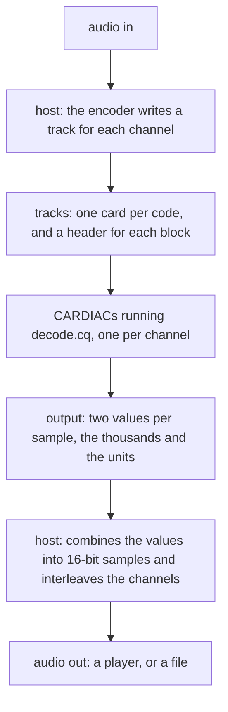
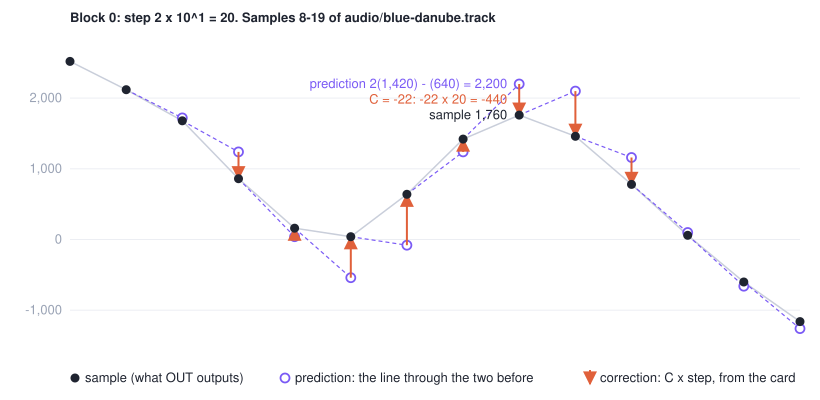
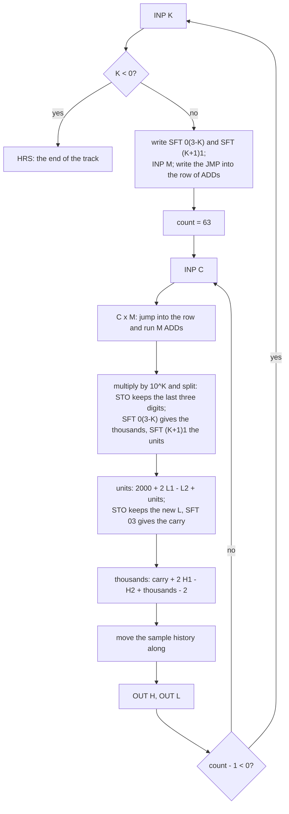
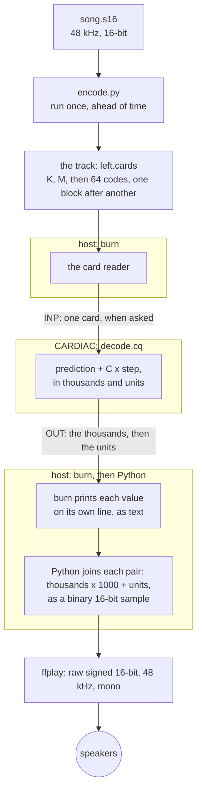
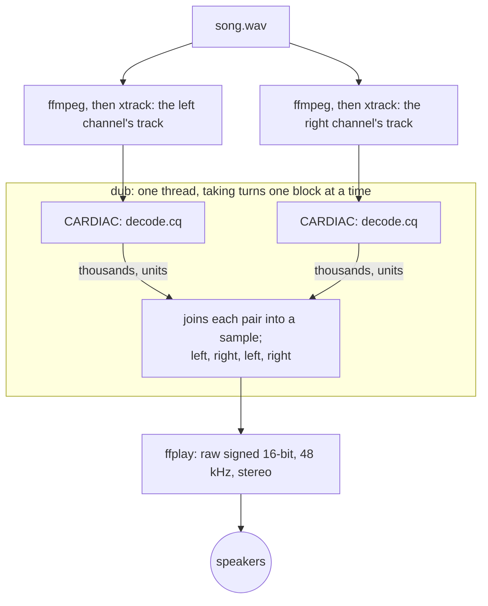

# Playing audio with CARDIAC math

Our goal was to play CD-quality sound (48,000 samples per second, 16 bits per sample) in which every sample is
calculated by a CARDIAC. The host computer is allowed to feed cards to the machine and to send the numbers it
outputs to the speakers. It is not allowed to do the arithmetic.

We tested everything on The Blue Danube, Johann Strauss II's waltz, in a recording by the United States Marine Band
from around 1972. It is nine minutes long and in the public domain ([audio/README.md](../audio/README.md) says
where it comes from). It suits a codec test because it has very soft passages and a big, loud section, and the codec
has to handle both: tiny changes from one sample to the next in the soft parts, and huge ones in the loud parts.
Unless we say otherwise, our test clip is the 32 seconds from 60 s to 92 s, mixed to mono. It starts in the softest
passage of the piece and swells into the loud section, and it contains the example track that ships with the
decoder.

Part 1 builds a mono player. It covers the coding scheme, the decoder written as a CARDIAC program, the encoder,
the shell pipe that first played a channel, and finally `lub`, the mono player as a program. Part 2 adds stereo and
ends with `dub`.

Everything described here is in this repository:

- The decoder is the CARDIAC program [`audio/decode.cq`](../audio/decode.cq).
- The encoder and the decoder's assembly live in the `lubdub` library ([`src/lib.rs`](../src/lib.rs)), which
  builds on [heartburn](https://github.com/StrangeQuery/heartburn), the CARDIAC engine.
- `xtrack` encodes a channel, `lub` plays one channel, and `dub` plays two ([`src/bin/`](../src/bin/)).
- [`encode.py`](encode.py), next to this page, is the encoder as we first wrote it, in Python. We used it as the
  reference when we wrote the Rust version.

## Part 1: A mono player

### What CARDIAC gives us

- **Memory.** 100 cells, each holding three digits and a sign (-999 to 999). Cell 00 always holds 001, the
  loader uses cells 01 and 02, and every JMP writes to cell 99. That leaves a program cells 03 to 98, which is 96
  cells.
- **The accumulator.** Four digits and a sign (-9999 to 9999).
- **Instructions.** ADD, SUB, CLA, STO, TAC (jump if negative), JMP, INP, OUT and HRS. There is no multiply and
  no divide.
- **SFT** shifts the accumulator's digits left and then right by whole decimal places. It keeps the sign.
- **STO** stores only the last three digits of the accumulator, with its sign. For example, 2,040 is stored as
  40, and -2,040 as -40.

### The overall design: tracks in, samples out

Everything we built follows the same path:

1. The host reads the audio file.
2. The host encodes each channel ahead of time into a **track**. A track is a file of CARDIAC cards, one per line.
3. A CARDIAC loads the decoder. Its INP instructions then read the track's cards one at a time, and it outputs
   two values for every sample.
4. The host combines those values into an audio stream and sends it to a player or to a file.

It has to work this way because a single CARDIAC value doesn't have enough levels for good sound. A value from
-999 to 999 has 1,999 possible levels, which is about 11 bits. CD audio has 65,536 levels (16 bits). With only one
value per sample, quiet passages would get just a handful of levels, and you would
hear hiss under every one of them. So each sample has to leave the CARDIAC as more than one value, and something
has to put the values back together in the format the sound card expects. That is the host's last step. It is a
change of format, like printing a number in decimal. All of the decoding (every prediction, every correction and
every carry) happens on the CARDIAC.



### Why not MP3 or AAC?

Compressed formats like MP3 and AAC are built on mathematical transforms that are full of multiplications.
CARDIAC would have to do every one of those multiplications as a loop of ADDs. That would take a couple of
processor cores' worth of work, and it would be a large program to write. Small files aren't our goal anyway. We
wanted a decoder simple enough to run exactly on CARDIAC.

### ADPCM: predict, then correct

ADPCM (adaptive differential pulse-code modulation) predicts each sample from the samples before it. Instead of the
sample itself, it sends only a correction: a small code, multiplied by a step size. To decode a sample you make the
prediction and add the correction. The hard part is choosing each code, and that is the encoder's job. The encoder
runs once, ahead of time, on an ordinary computer. That division of labour suits CARDIAC well.

### How many digits per sample?

A card holds three digits. We tried both extremes:

- **One digit per sample**, so three samples fit on each card. That gives ten levels, about 3.3 bits, which is
  similar to the 4-bit ADPCM used in 90s video games.
- **Three digits per sample**, so one sample per card. The code runs from -500 to 499.

File size wasn't the goal, so the number of cards didn't decide it. On our test clip, one digit per sample reached
38.5 dB signal-to-noise, and three digits reached 76.9 dB. (These use the block headers described in the next
section.) A difference of 38 dB means the three-digit version's errors are about 80 times smaller. We use three
digits.

### Adapting the step size

Our first version adjusted the step size as it went, based on the codes themselves, the way IMA ADPCM does. A large
code made the step grow and a small one made it shrink. That worked badly on this recording, because the music
keeps jumping from soft to loud:

| Clip | 1 digit | 3 digits |
|---|---|---|
| The test clip, step adapted from the codes | 28.3 dB | 42.1 dB |

With three digits, 9,320 of the clip's 1,536,000 codes hit the ends of their range. The step size couldn't grow
fast enough to keep up with the music (this is called slope overload). We tried rules that made the step grow
faster, on the 8 seconds from 84 s. They helped three digits, from 40.4 dB up to 55.2 dB, but made one digit
worse, from 27.8 dB down to 20.4 dB.

The fix is the one used by the sound chips in the PlayStation and the SNES. The encoder chooses the step size for
each short block of samples and sends it as a header at the start of the block. On CARDIAC that costs only a few
extra cards. These are the results for the 4 seconds starting at 86 s, in the loud section:

| Block | 1 digit | 3 digits |
|---|---|---|
| 16 samples | 37.3 dB | |
| 28 samples | 36.3 dB | |
| 32 samples | | 75.4 dB |
| 64 samples | | 74.1 dB |

We use blocks of 64 samples, so there are two header cards for every 64 code cards.

### Step sizes CARDIAC can multiply by

Every sample needs the code C multiplied by the step size, and CARDIAC can't multiply. So we restricted the step
size to M x 10^K, where M is from 1 to 9 and K is from 0 to 3:

- **Multiplying by M** uses a row of nine `ADD c` instructions. The decoder jumps into the row at the point that
  leaves exactly M of them to run.
- **Multiplying by 10^K** is a shift of K digits, which is a single SFT instruction.

K stops at 3 because the shift that extracts the thousands is `SFT 0(3-K)`. Our first attempt allowed only 1, 2
or 5 for M. Allowing any value from 1 to 9 costs nothing extra, because the row of ADDs is there anyway, and it
gives the encoder finer steps to choose from.

The largest product, C x M, is 499 x 9 = 4,491. That still fits in the accumulator.

### The prediction, and the 106-cell problem

We considered letting each block choose between two predictions:

- **the previous sample**, or
- **a straight line through the previous two samples**: twice the previous sample, minus the one before it. This
  needs only additions and a subtraction.

A decoder that let each block choose came to about 106 cells, and only 96 are free. The choice would need another
header card, which would rewrite four more instructions (an ADD or SUB of the sample history, or of a zero), plus
the code to build those instructions. So we measured what the choice was actually worth, using one second at each
of eight points in the piece, four soft and four loud:

| Second | Loudness | Either, chosen per block | Line only | Previous sample only |
|---|---|---|---|---|
| 62 | soft | 94.6 | 94.6 | 94.6 |
| 87 | loud | 75.7 | 75.7 | 71.8 |
| 150 | loud | 76.9 | 76.9 | 72.3 |
| 210 | loud | 88.7 | 88.7 | 75.3 |
| 362 | soft | 89.3 | 89.3 | 89.3 |
| 388 | loud | 71.2 | 71.0 | 67.8 |
| 510 | soft | 91.3 | 91.3 | 91.3 |
| 540 | loud | 60.5 | 59.3 | 60.1 |

(signal-to-noise, in dB)

Using the straight line on its own costs at most 1.2 dB, and it never drops below 59.3 dB. Using only the
previous sample would cost up to 13.4 dB. So the straight line alone is a good compromise, and it fits in
memory. So the straight line is the only prediction, and each block's header is just two cards, K and M.

The figure below shows the prediction at work on twelve samples of the example track, where the block's step size
is 20. Each hollow circle is where the line through the two previous samples lands. Each arrow is the correction,
C times the step size, that moves the prediction to the actual sample. Where the music bends, the line overshoots
and the corrections are large. Where it runs straight, the circles sit almost on top of the samples, and the codes
are small.



### Fitting a 16-bit sample into three-digit cells

A 16-bit sample runs from -32,768 to 32,767. That fits neither in a cell nor in the accumulator. So the decoder
keeps each sample in two cells: H, the thousands, and L, the units from 0 to 999. The sample is H x 1000 + L. For
example, -12,345 is stored as H = -13 and L = 655.

The correction C x M x 10^K is split the same way, into a thousands part and a units part, by two SFT
instructions. Both parts keep the correction's sign. To keep the sum of the units from going negative, the decoder
adds a bias of 2000:

    sum = 2000 + 2 L1 - L2 + units       (between 2 and 4,997)
    L   = the last three digits of sum    (STO keeps exactly these)
    H   = (sum shifted right three digits, the carry from 0 to 4) + 2 H1 - H2 + thousands - 2

Here L1 and H1 are the previous sample, and L2 and H2 are the one before it. The bias means the carry comes out of
a plain shift, and the -2 at the end removes the bias again.

### The block header rewrites the program

Each block's header is two numbers, K and M. The decoder uses them to write three of its own instructions:

| Cell | Becomes | Built as |
|---|---|---|
| `mul` | a JMP into the row of ADDs, M instructions from its end | `JMP x1`, minus M, plus 1 |
| `shi` | SFT 0(3-K), which extracts the thousands | 403 - K |
| `slo` | SFT (K+1)1, which extracts the units | 411 + 10 K |

That way the track contains only plain numbers, not instructions that depend on where the decoder keeps things in
memory. A K below zero marks the end of the track.

### A bug: a product too big for a cell

The first version of the decoder stored C x M in a cell and then shifted the thousands and the units out of that
cell. But a cell holds only three digits, and C x M can have four, so the thousands were lost. In our first
test, a sample that should have been 2,040 came out as 40. Comparing against the encoder's expected output caught it on
sample 0, and stepping through in `ekg` showed why: after `SFT 03`, the thousands were 0, because the cell being
shifted held 040.

The fix costs nothing. The units depend only on the last three digits, which is exactly what STO keeps. So the
decoder stores C x M (keeping its last three digits), shifts the thousands out of the accumulator, which still holds
all four digits, and then reloads the stored digits to get the units.

### What the decoder does for each sample

| Cells | Instructions | What happens |
|---|---|---|
| 19-21 | 3 | INP reads the code C, the accumulator is cleared, and the program jumps into the row of ADDs |
| 22-30 | M | the row of ADDs computes C x M |
| 31-36 | 6 | multiply by 10^K and split into thousands and units |
| 37-43 | 7 | the units: 2000 + 2 L1 - L2 + units; STO keeps the new L |
| 44-50 | 7 | the thousands: carry + 2 H1 - H2 + thousands - 2 |
| 51-58 | 8 | the previous sample becomes the one before it, and the new sample becomes the previous one |
| 59-60 | 2 | OUT the thousands, then OUT the units |
| 61-65 | 5 | count down the block; at the end of the block, go back and read the next header |

That is 38 + M instructions per sample, plus 16 instructions for each block's header.



### The first three samples, cell by cell

This section follows the example track, [`audio/blue-danube.track`](../audio/blue-danube.track), so you can step
through it in `ekg` or Cardigan and check each number against this table. ([audio/README.md](../audio/README.md)
says how.) The track starts with the cards `1 2 332 -273 -52`. That is a header with K = 1 and M = 2, which gives a
step size of 2 x 10 = 20, followed by the first three codes. Because K is 1, the header turns the two shift
instructions into `SFT 02`, which extracts the thousands, and `SFT 21`, which extracts the units. The decoder starts
with every history cell at 0.

| | Sample 0 | Sample 1 | Sample 2 |
|---|---|---|---|
| The card C (cell `c`) | 332 | -273 | -52 |
| C x M | 664 | -546 | -104 |
| Stored by STO, the last three digits (cell `u`) | 664 | -546 | -104 |
| Thousands: `SFT 02` of C x M (cell `hi`) | 6 | -5 | -1 |
| Units: `SFT 21` of the stored value (cell `lo`) | 640 | -460 | -40 |
| History before: H1, L1 and H2, L2 | 0, 0 and 0, 0 | 6, 640 and 0, 0 | 7, 820 and 6, 640 |
| Units sum: 2000 + 2 L1 - L2 + units (the accumulator at cell 44) | 2,640 | 2,820 | 2,960 |
| New L, and the carry | 640, carry 2 | 820, carry 2 | 960, carry 2 |
| New H: carry + 2 H1 - H2 + thousands - 2 | 2 + 0 - 0 + 6 - 2 = 6 | 2 + 12 - 0 - 5 - 2 = 7 | 2 + 14 - 6 - 1 - 2 = 7 |
| OUT | 6, then 640 | 7, then 820 | 7, then 960 |
| The sample | 6,640 | 7,820 | 7,960 |
| Check: prediction + C x step | 0 + 6,640 | 13,280 - 5,460 | 9,000 - 1,040 |

The prediction for sample 1 is 2 x 6,640 - 0 = 13,280, and the prediction for sample 2 is 2 x 7,820 - 6,640 = 9,000.
The decoder never forms those five-digit numbers. It works in thousands and units the whole time, and the carry
joins the two.

To see these numbers on the CARDIAC, stop at cell 44 to read the units sum in the accumulator, and at cell 59, the
first OUT, to read the cells `c`, `u`, `hi`, `lo`, `h1`, `l1`, `h2` and `l2`.

### The decoder listing

This is [`audio/decode.cq`](../audio/decode.cq), in heartburn's six-column listing format. `carc audio/decode.cq`
turns it into the deck `audio/decode.cqb`. `lub` and `dub` have the listing built in and assemble it the same way
`carc` does.

```
; Decimal ADPCM decoder. It reads a track of cards and outputs 16-bit samples. Each sample is output as two
; values: first the thousands, then the units (0-999). The sample is thousands * 1000 + units.
;
; A track is made of blocks of 64 samples. Each block starts with two header cards, K (0-3) and M (1-9), and the
; block's step size is M * 10^K. After the header comes one card per sample, a code C from -500 to 499. Each sample
; is a prediction plus C times the step size. The prediction is a straight line through the previous two samples:
; twice the previous sample, minus the one before it. A K below zero marks the end of the track.
;
; Each sample is kept in two cells: H holds the thousands and L holds the units (0-999). The header writes three
; instructions into the program. The first is a jump into a row of nine ADDs, placed so that exactly M of them run;
; that multiplies C by M. The other two are SFTs that split C * M * 10^K into thousands and units: SFT 0(3-K) and
; SFT (K+1)1. Both keep the sign. C * M can have four digits, which a cell can't hold, so the thousands are shifted
; out of the accumulator, and the units come from the last three digits, which is what STO keeps. The units are
; summed on top of 2000 so the sum never goes negative. STO then keeps the new units, and SFT 03 gives the carry.
;
; Address Contents Label Opcode Operand Comment
  03            block   INP   k        03-18: the header
  04                    CLA   k
  05                    TAC   done
  06                    SFT   10       SFT (K+1)1 for the units
  07                    ADD   s411
  08                    STO   slo
  09                    CLA   s403     SFT 0(3-K) for the thousands
  10                    SUB   k
  11                    STO   shi
  12                    INP   m
  13                    CLA   jx1      JMP into the row, M ADDs from its end
  14                    SUB   m
  15                    ADD   00
  16                    STO   mul
  17                    CLA   n
  18                    STO   cnt
  19            sample  INP   c        19-31: C * M
  20                    CLA   z
  21            mul     DATA  0        (JMP x1+1-M)
  22                    ADD   c
  23                    ADD   c
  24                    ADD   c
  25                    ADD   c
  26                    ADD   c
  27                    ADD   c
  28                    ADD   c
  29                    ADD   c
  30            x1      ADD   c
  31                    STO   u        31-36: * 10^K, split: the units come from C * M's last three digits
  32            shi     DATA  0        (SFT 0(3-K))
  33                    STO   hi
  34                    CLA   u
  35            slo     DATA  0        (SFT (K+1)1)
  36                    STO   lo
  37                    CLA   two      37-43: the units, 2000 + 2 L1 - L2 + lo
  38                    SFT   30
  39                    ADD   l1
  40                    ADD   l1
  41                    SUB   l2
  42                    ADD   lo
  43                    STO   ln
  44                    SFT   03       44-50: the thousands, carry + 2 H1 - H2 + hi - 2
  45                    ADD   h1
  46                    ADD   h1
  47                    SUB   h2
  48                    ADD   hi
  49                    SUB   two
  50                    STO   hn
  51                    CLA   l1       51-58: the last becomes the one before
  52                    STO   l2
  53                    CLA   ln
  54                    STO   l1
  55                    CLA   h1
  56                    STO   h2
  57                    CLA   hn
  58                    STO   h1
  59                    OUT   h1       59-60: the sample
  60                    OUT   l1
  61                    CLA   cnt      61-65: the next, or the next block's header
  62                    SUB   00
  63                    STO   cnt
  64                    TAC   block
  65                    JMP   sample
  66            done    HRS   00
  70            k       DATA  0
  71            m       DATA  0
  72            c       DATA  0
  73            u       DATA  0
  74            lo      DATA  0
  75            hi      DATA  0
  76            ln      DATA  0
  77            hn      DATA  0
  78            cnt     DATA  0
  79            n       DATA  63       a block is 64 samples
  80            two     DATA  2
  81            s411    DATA  411
  82            s403    DATA  403
  83            jx1     JMP   x1
  84            z       DATA  0
  85            l1      DATA  0
  86            l2      DATA  0
  87            h1      DATA  0
  88            h2      DATA  0
```

It uses 83 of the 96 free cells: the code is in cells 03 to 66 and the data in cells 70 to 88.

### The encoder

`encode.py` encodes one channel. For each block, it finds the farthest any sample strays from the prediction, and
takes the smallest step size whose codes reach that far. (It used to try all 36 step sizes; the next section says
why it doesn't any more.) It encodes "closed loop": it chooses each code against the sample the decoder will actually
produce, not against the original, so small errors never add up over time. It never lets a sample go outside 16
bits. Besides the cards, it can also write out the samples the decoder should produce, and that is what we check
the decoder against.

```python
#!/usr/bin/env python3
"""Encode one channel of raw 48 kHz stereo 16-bit audio as a track for decode.cq.

    encode.py IN.s16 CHANNEL START_S SECONDS CARDS [EXPECT]

CHANNEL is 0 for the left channel or 1 for the right. The track is written to CARDS, one card per line. If EXPECT
is given, the samples the decoder should output are written there, one per line. For each block of 64 samples, the
encoder picks the smallest step size M * 10^K (M from 1 to 9, K from 0 to 3) whose codes reach as far as the block
strays from the prediction (twice the previous sample, minus the one before it). It chooses each code against the
decoder's own prediction, and it never lets a sample go outside 16 bits.
"""
import struct, sys

N = 64
STEPS = [(k, m) for k in range(4) for m in range(1, 10)]

def block(xs, s1, s2, step):
    out = []
    for x in xs:
        e = 2 * s1 - s2
        lo, hi = max(-500, -((32768 + e) // step)), min(499, (32767 - e) // step)
        if lo > hi:
            return None   # this step can't keep a sample within 16 bits
        c = max(lo, min(hi, round((x - e) / step)))
        s = e + c * step
        out.append((c, s))
        s2, s1 = s1, s
    return out

def encode(xs):
    cards, samples, s1, s2 = [], [], 0, 0
    for b in range(0, len(xs), N):
        blk = xs[b:b + N]
        blk += [blk[-1]] * (N - len(blk))
        p = [s2, s1] + blk
        far = max(abs(p[i] - (2 * p[i - 1] - p[i - 2])) for i in range(2, len(p)))
        out, k, m = next((o, k, m) for k, m in STEPS if 499 * m * 10**k >= far
                         for o in [block(blk, s1, s2, m * 10**k)] if o)
        cards += [k, m] + [c for c, _ in out]
        samples += [s for _, s in out]
        s1, s2 = out[-1][1], out[-2][1]
    return cards + [-1], samples

def main():
    src, ch, start, secs, dst = sys.argv[1], int(sys.argv[2]), float(sys.argv[3]), float(sys.argv[4]), sys.argv[5]
    with open(src, "rb") as f:
        f.seek(int(start * 48000) * 4)
        raw = f.read(int(secs * 48000) * 4)
    xs = list(struct.unpack(f"<{len(raw) // 2}h", raw)[ch::2])
    cards, samples = encode(xs)
    with open(dst, "w") as f:
        f.write("\n".join(map(str, cards)) + "\n")
    if len(sys.argv) > 6:
        with open(sys.argv[6], "w") as f:
            f.write("\n".join(map(str, samples)) + "\n")

main()
```

It takes 0.9 seconds to encode the 32-second test clip. `xtrack` is the same encoder written in Rust
(`lubdub::encode`). It writes exactly the same track, card for card, in 0.03 seconds. It even rounds halves to the
nearest even number, as Python's `round` does, so that the two agree. Both have one safeguard. Sometimes the
prediction overshoots so far that a small step size can't bring the sample back inside 16 bits. When that happens,
the encoder moves on to the next larger step size. The largest, 9,000, can always reach, so every block still gets
a step size.

### The search we didn't need

Our first encoder tried all 36 step sizes on every block, coded the block with each one, and kept the one with the
least squared error. That is 36 times the work of coding the block once, and we assumed it was what bought us the
quality. When we finally measured it, it wasn't.

We put the search up against the one-pass rule above, which looks at each block once and never tries a step size.
On the test clip:

| Encoder | Signal-to-noise |
|---|---|
| One value per sample (1,999 levels), no prediction | 48.4 dB |
| One step size for the whole clip | 60.5 dB |
| A step size for each block, by the one-pass rule | 77.79 dB |
| A step size for each block, all 36 tried | 77.83 dB |

The search buys 0.04 dB, which nobody can hear. Over the whole nine-minute piece it is the same story: 68.97 dB
against 68.94 on the left channel, and 74.80 against 74.74 on the right. The rule's worst single error is actually
smaller, 45 against 90 on the left and 25 against 44 on the right. The search keeps whichever step size has the
least error in total, even when that step size lets one sample miss by a lot. The rule doesn't pick a step size
too small to reach.

The reason is in the tracks. Of the test clip's 24,000 blocks, 20,360 (85%) use a step size of 1, and another 9%
use 2. At 48,000 samples per second, music changes so little from one sample to the next that the prediction is
rarely more than 499 off, and a step size of 1 can reach anything within 499. So most blocks are coded exactly,
and the CARDIAC gives back the recording sample for sample. When a block does need a larger step size, the
smallest one that reaches is nearly always the best one too, so there is nothing for a search to find.

The search does earn its keep when the codes are coarse. With one digit per sample and blocks of 32, it gets
39.0 dB, and the one-pass rule gets 37.2. Three digits leave it nothing to do. So `xtrack` now uses the rule, and
encodes 16 times as fast as before: 0.5 seconds for one channel of the whole piece, instead of 8.4.

### Tracks are CARDIAC input

A track contains nothing but CARDIAC cards: one number per line, each from -999 to 999. First come each block's
two header cards, then its 64 code cards, and at the very end a -1 that makes the decoder halt. Once the decoder is
loaded, every card goes into the card reader exactly as it appears in the file, and the decoder's INP
instructions read them one by one. The host doesn't change a single card on the way in.

That is why plain `burn` can run a track with no help at all:

```sh
carc audio/decode.cq                                   # assemble the decoder into audio/decode.cqb
burn audio/decode.cqb < audio/blue-danube.track       # the example track: 128 samples
```

`burn` loads the decoder deck and then feeds it the track as input cards, exactly as it would feed
`burn add.cqb -- 123 456`. A track is simply a long input deck. For a track longer than a few minutes, add
`--limit=100000000000`, because `burn` normally stops a program after a billion instructions, and a whole channel
of The Blue Danube takes slightly more than that.

`burn` doesn't play audio, though. It prints every value the program outputs as a decimal number on its own line.

### The first player: a shell pipe

This is how we first played a channel, using the Python encoder, `burn`, and a few lines of Python to join the
values. The input is a raw audio file: nothing but 48 kHz stereo samples, each a signed 16-bit little-endian
number, with no header. We give such files the extension `.s16`. The first command below makes one from a wav
file with `ffmpeg`. Run these from the top of the repository after building the tools:

```sh
B=target/release
ffmpeg -i song.wav -ar 48000 -ac 2 -f s16le song.s16
S=song.s16

# assemble the decoder once; this writes audio/decode.cqb
$B/carc audio/decode.cq

# encode the left channel, 32 seconds starting at 60 s:
# the cards, and the samples the decoder should produce
python3 docs/encode.py $S 0 60 32 left.cards left.expect

# decode it on a CARDIAC; 32 seconds of one channel is about 61 million instructions
$B/burn --limit=100000000000 audio/decode.cqb < left.cards > left.out
```

**Checking the result.** `burn` prints each output value on its own line, so every sample takes two lines: the
thousands, then the units. This joins them and compares them with the encoder's expected samples:

```sh
python3 -c '
import sys; f = sys.argv[1]
o = [int(x) for x in open(f + ".out")]
got = [o[i] * 1000 + o[i + 1] for i in range(0, len(o), 2)]
print(f, "matches" if got == [int(x) for x in open(f + ".expect")] else "DIFFERS")
' left
```

**Playing it while it decodes.** `burn` reads each card at the moment an INP asks for it, and it prints each value
at the moment OUT produces it. So a pipe can play the channel while the CARDIAC is still decoding it. A few lines
of Python join each pair of values into a 16-bit sample, and `ffplay` sends the raw samples to the speakers:



```sh
$B/burn --limit=100000000000 audio/decode.cqb < left.cards \
  | python3 -c '
import sys, struct
out = sys.stdout.buffer
for h in sys.stdin:
    out.write(struct.pack("<h", int(h) * 1000 + int(next(sys.stdin))))' \
  | ffplay -nodisp -autoexit -f s16le -ar 48000 -ch_layout mono -
```

The Python step is the host's combining step, the last one on the path. It reads `burn`'s output two lines at a
time (a sample's thousands, then its units) and writes the sample as two binary bytes, least significant first.
For example, 1,992 goes to `ffplay` as the bytes `C8 07`. Raw samples have no header, so `ffplay` has to be told
what they are: `-f s16le` means signed 16-bit little-endian, `-ar 48000` is the sample rate, and `-ch_layout mono`
means one channel.

The CARDIAC decodes far faster than real time, so the sound card sets the speed. When the pipe is full, `burn`
waits for the speakers to catch up.

### lub: the mono player in Rust

The pipe above has a weak spot: the joining is done by a Python one-liner. `lub` does the same job as `burn` and
the Python together, in Rust. The decoding itself lives in the library, as `lubdub::Channel`: one
CARDIAC running the decoder, which is given the track's next 66 cards (a header and 64 codes) each time it is
asked for a block, and runs until it wants more. `lub` is a thin wrapper of about 100 lines, including its help
text and error messages. It reads the track, asks the `Channel` for one block of samples after another, and writes
each block to standard output as soon as it is decoded.

Think of the difference between a terminal's numeric mode and its character mode. OUT only ever produces numbers;
the device at the other end decides what they mean. `burn` prints them as digits. A terminal in character mode
shows 65 as "A". `Channel` treats each pair of numbers as one audio sample. Every value the CARDIAC outputs
arrives at this function in the library:

```rust
impl Console for Pairs {
    fn output(&mut self, value: i32) {
        let Some(thousands) = self.thousands.take() else {
            self.thousands = Some(value);
            return;
        };
        match sample(thousands, value) {
            Some(s) => self.decoded.push(s),
            None => {
                self.error.get_or_insert(Error::NotASample(thousands, value));
            }
        }
    }
}
```

The first value of each pair is held as the thousands, and the second completes the sample. `sample` checks that
the pair really is a sample (the units must be 0 to 999 and the result must fit in 16 bits) and computes thousands
x 1000 + units. If a pair isn't a sample, the error is kept, and the `Channel` returns it instead of the block.
`lub` writes each sample as two little-endian bytes.

`xtrack` makes the track, and `lub` plays it:

```sh
ffmpeg -i song.wav -af 'pan=mono|c0=c0' -ar 48000 -f s16le - | $B/xtrack > song.left.track
$B/lub song.left.track | ffplay -nodisp -autoexit -f s16le -ar 48000 -ch_layout mono -
```

`lub` produces exactly the same bytes as the `burn` and Python pipe. When something is wrong, it stops with a
message instead of playing noise: if a track has no end card, if a line isn't a card, or if the decoder's two
values aren't a 16-bit sample. If the player stops reading, `lub` quietly stops too. The tests
(`tests/audio.rs`, and the tests in `src/lib.rs`) check that the CARDIAC's samples exactly match the encoder's
expected samples, both through the library and through the programs.

### Results

| | |
|---|---|
| Exactness | The decoder's output matches the encoder's expected samples on all 1,536,000 samples of each channel of the test clip in stereo, through `burn` and through `lub`. |
| Quality | 77.8 dB signal-to-noise over the test clip. |
| Speed | 38 + M instructions per sample, 39.5 on average including the headers and the loader (60.6 million for 1,536,000 samples). That is about 1.9 million instructions per second for one channel at 48 kHz. |
| Memory | 83 of the 96 free cells. |
| Encoding | `xtrack` takes 0.03 s for the test clip and 0.5 s for one channel of the whole nine-minute piece. The Python version takes 0.9 s for the test clip. |
| Track size | 66 cards for every 64 samples, plus one card at the end: 1,584,001 cards (5.2 MB as text) for the test clip. |
| The whole piece | 27.2 million cards per channel, 54.4 million for stereo. Stored as 2 bytes per card, that is 109 MB, about the same size as the raw 16-bit audio (105 MB). As text it is 186 MB. |

## Part 2: Stereo

### Two channels, two CARDIACs

A stereo recording has two channels, left and right. The two channels can be decoded completely separately. Each
decoder keeps its own history of recent samples and reads its own block headers, and neither needs anything from
the other. So for stereo we run two CARDIACs, both running `decode.cq`, one for each channel, each reading its own
track.

### Stereo the batch way

The first stereo clip was made by running `burn` once for each channel and writing the two outputs into a wav file:

```sh
python3 docs/encode.py $S 0 60 32 left.cards  left.expect
python3 docs/encode.py $S 1 60 32 right.cards right.expect
$B/burn --limit=100000000000 audio/decode.cqb < left.cards  > left.out
$B/burn --limit=100000000000 audio/decode.cqb < right.cards > right.out

python3 -c '
import struct, wave
ch = []
for f in ("left", "right"):
    o = [int(x) for x in open(f + ".out")]
    ch.append([o[i] * 1000 + o[i + 1] for i in range(0, len(o), 2)])
w = wave.open("cardiac.wav", "wb"); w.setnchannels(2); w.setsampwidth(2); w.setframerate(48000)
w.writeframes(b"".join(struct.pack("<hh", a, b) for a, b in zip(*ch))); w.close()
'
afplay cardiac.wav
```

That decodes everything first and plays it afterwards. To stream stereo, the two channels' samples have to be
interleaved as they are made (left, right, left, right), and a shell pipe can't easily do that.

### dub: two CARDIACs on one thread

Decoding both channels costs about 4 million instructions per second, so giving each channel its own thread would
gain nothing and would add the work of keeping the threads in step. Instead, `dub` uses one thread and two
CARDIACs, and the two take turns, one block at a time. On each turn, a channel's CARDIAC is given the next 66 cards
of its track (one header and 64 codes). It runs until it asks for more cards, which is exactly one block of 64
samples. Then it is the other channel's turn. Each machine is still a plain mono decoder, with its own 100 cells
and its own track. This logic is in the library too, as `lubdub::Stereo`, a pair of `Channel`s. `dub`
only reads the two tracks and writes out the blocks `Stereo` gives it.

```sh
ffmpeg -i song.wav -af 'pan=mono|c0=c1' -ar 48000 -f s16le - | $B/xtrack > song.right.track
$B/dub song.left.track song.right.track | ffplay -nodisp -autoexit -f s16le -ar 48000 -ch_layout stereo -
```

This is the same path as the mono player, with two of everything in the middle: two tracks, two CARDIACs, and two
streams of output values. The host's combining step joins each channel's thousands and units as before. Then it
interleaves the channels, left then right, because that is what a stereo stream is. The `-ch_layout stereo` flag
tells `ffplay` to expect exactly that.



`dub`'s output is byte for byte the two channels of the batch way above, interleaved, and it takes 0.24 s for
the 32-second test clip. If the two tracks are different lengths, `dub` reports an error that names the longer track and
says by how many samples. It doesn't play one channel on its own.

### Using the decoder from your own program

`Channel` and `Stereo` are the same code `lub` and `dub` run, so a program of your own can decode tracks exactly
the way they do. This reads two tracks and decodes them as stereo, block by block:

```rust
use heartburn::tape;

let left = tape::values(&std::fs::read_to_string("song.left.track")?)?;
let right = tape::values(&std::fs::read_to_string("song.right.track")?)?;
let mut stereo = lubdub::Stereo::new(left.into_iter(), right.into_iter());
while let Some(block) = stereo.next_block().map_err(|(side, e)| format!("{side:?} track: {e}"))? {
    for [left, right] in block {
        // two 16-bit samples, decoded by the two CARDIACs
    }
}
```

Each call to `next_block` lets each CARDIAC decode one block of 64 samples. An error comes back as a value, saying
which channel it came from: a track that ends without its end card, a card out of range, a pair of values that
isn't a sample, or tracks of different lengths. `Channel::steps` says how many CARDIAC instructions a channel has
run, if you want to count them.

### Alternatives we rejected

- **One CARDIAC alternating between the channels.** This would need twice as many history cells, and one program
  would have to keep track of two decoders' state. It costs the same and is harder to read, so it gains nothing.
- **Mid and side.** One machine would encode left + right and the other left - right. When the two channels are
  similar, the difference needs fewer digits. But file size isn't our goal, and undoing the mid/side split would
  put arithmetic back on the host.

### Why the tracks are made ahead of time

The encoder works one block at a time, and each block depends only on its own 64 samples and the last two samples
the decoder produced. So the host could encode each block a few milliseconds before the CARDIAC needs it, and
`xtrack` is fast enough to do that on about 0.2% of one core for stereo.

We don't, for two reasons. First, encoding is arithmetic: for every sample the encoder predicts, divides and
rounds. If the host did that live, it would be doing about as much arithmetic as the CARDIACs, which is exactly
what the host isn't allowed to do. Second, it would be circular. To encode live, the host would need the
raw audio in memory, and then it could simply play that audio directly.

A track isn't a pre-rendered result. It is the music stored in the form the player reads, just as a demo ships a
packed music file and decodes it as it plays. Nothing is computed ahead of time except the encoding. Every sample
is still decoded by a CARDIAC at the moment it is played.

### Still to do

- A binary card format for long tracks (2 bytes per card), so that a whole piece isn't 186 MB of text.
- Playing in step with a picture, which means handing the samples to the sound card on a clock, instead of as fast
  as the pipe will take them.
